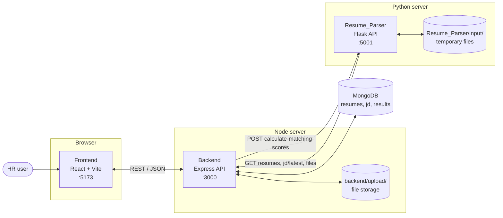
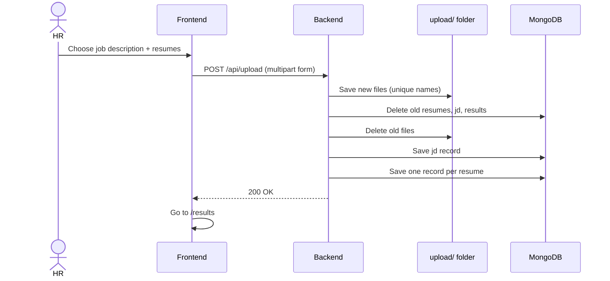
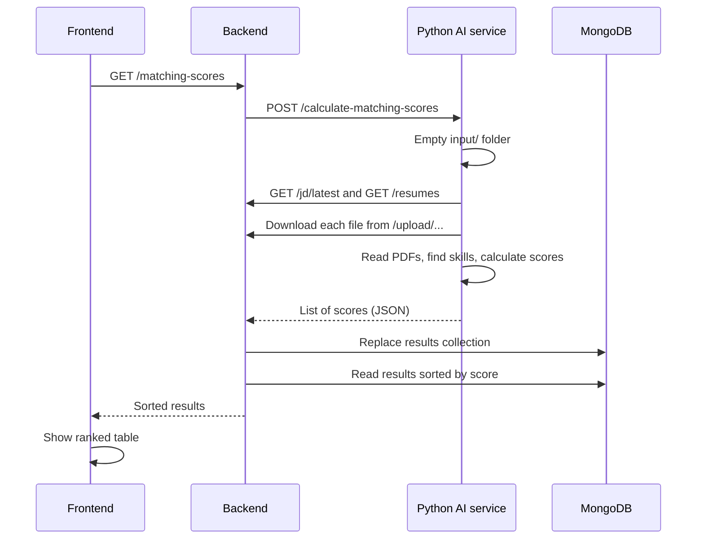

# Resume Parser Using AI - Project Overview

An application that helps HR teams find the best candidates quickly. The user uploads **one job description** and **many resumes**. The system reads them, finds the skills in each document and ranks the resumes by how well they match the job.

> For installation steps see [SETUP.md](SETUP.md). For details of the AI module see [Resume_Parser/README.md](Resume_Parser/README.md).

---

## 1. What the project does

1. HR uploads a job description (PDF) and one or more resumes.
2. The files are stored and recorded in a database.
3. An AI module reads the files, extracts skills and calculates a match score (0 to 100) for each resume.
4. The website shows a ranked table with scores, matched skills and a link to each resume.

---

## 2. Technology stack

| Layer | Technology | Purpose |
|-------|------------|---------|
| Frontend | React 18, Vite, Tailwind CSS, React Router, Axios | The website the user sees. |
| Backend | Node.js, Express, Multer, Mongoose | API, file upload, file storage, talking to the database and to the AI service. |
| Database | MongoDB | Stores resume records, job descriptions and results. |
| File storage | Local folder `backend/upload/` | Holds the uploaded files. |
| AI service | Python, Flask, spaCy, scikit-learn, PyMuPDF | Reads PDFs, finds skills, calculates scores. |

---

## 3. High-level architecture

The system has **three applications** and **one database**. Each one has a single clear job.



### Responsibilities

| Component | Folder | Responsible for | Does NOT do |
|-----------|--------|-----------------|-------------|
| **Frontend** | `frontend/` | Upload form, loading and error states, results table (search, sort). | Store data or read resumes. |
| **Backend** | `backend/` | Receive uploads, save files, save records, serve files, call the AI service, save scores. | Understand resume content. |
| **AI service** | `Resume_Parser/` | Download files, extract text and skills, calculate scores. | Store anything permanently. |
| **MongoDB** | (external) | Permanent records. | - |

Why split it this way? Each part can be changed or replaced on its own. For example, the AI scoring can be improved without touching the website, and the file storage can be moved to the cloud without touching the AI.

---

## 4. Main workflow

### 4.1 Upload



Every new upload **replaces** the previous data, so each run starts clean.

### 4.2 Matching and results



---

## 5. Components in more detail

### 5.1 Frontend (`frontend/`)

| Part | File | Description |
|------|------|-------------|
| Routing | `src/App.jsx` | `/` is the upload page, `/results` is the results page. |
| Layout | `src/components/Layout.jsx` | Header, step navigation and animated background. |
| Upload page | `src/pages/HRUpload.jsx` | Two drop zones, validation, error message. |
| Drop zone | `src/components/DropZone.jsx` | Drag and drop, file list, remove button. |
| Results page | `src/pages/SortedResumes.jsx` | Fetches scores and handles loading and error states. |
| Results table | `src/components/ResumeTable.jsx` | Summary cards, search, sorting, rank, score bar, skill chips. |
| API helper | `src/utils/api.js` | All HTTP calls. The base URL comes from `VITE_API_URL` and defaults to `http://localhost:3000`. |

### 5.2 Backend (`backend/`)

| Part | File | Description |
|------|------|-------------|
| Entry point | `server.js` | Sets up Express, CORS, static file serving and the API routes. |
| File upload | `multer.js` | Saves files to `backend/upload/` with unique names. Allows only `.pdf`, `.doc`, `.docx`. |
| Upload route | `routes/upload.js` | `POST /api/upload` accepts up to 50 resumes and 1 job description. |
| Upload logic | `controllers/upload.js` | Clears old data, saves new records, returns file URLs. |
| Database | `config/db.js` | Connects to MongoDB using `MONGODB_URI`. |
| Maintenance | `cleanup.js` | Optional script that deletes all stored records and uploaded files. |

**API endpoints**

| Method | Path | Purpose | Used by |
|--------|------|---------|---------|
| POST | `/api/upload` | Upload job description and resumes. | Frontend |
| GET | `/matching-scores` | Ask the AI service for scores, store them, return them sorted. | Frontend |
| GET | `/resumes` | List resume records (`filename`, `url`, `jobDescription`). | AI service |
| GET | `/jd/latest` | Newest job description record. | AI service |
| GET | `/upload/<file>` | Download or view a stored file. | Browser, AI service |

**Database collections**

| Collection | Model | Main fields |
|------------|-------|-------------|
| `resumes` | `Resume` | `filename`, `contentType`, `url`, `public_id`, `jobDescription` (URL) |
| `jd` | `JD` | `filename`, `contentType`, `url`, `public_id` |
| `results` | `Result` | `filename`, `matching_score`, `skills_matched`, `reference_id`, `url` |

### 5.3 AI service (`Resume_Parser/`)

A short summary of how a score is produced:

1. Download the newest job description and all resumes.
2. Extract the text of each PDF.
3. Find skills using a keyword list and a trained NER model.
4. Turn each skill list into word counts (Bag of Words).
5. Compare resume and job vectors with cosine similarity.
6. Return `matching_score` (0 to 100) and `skills_matched` for every resume.

The complete explanation, including the AI and ML concepts, is in [Resume_Parser/README.md](Resume_Parser/README.md).

---

## 6. Ports and configuration

| Service | Default address | Configured by |
|---------|-----------------|---------------|
| Frontend | `http://localhost:5173` | Vite default |
| Backend | `http://localhost:3000` | `PORT` in `backend/.env` |
| AI service | `http://localhost:5001` | Set in `Resume_Parser/main.py` |
| MongoDB | `MONGODB_URI` | `backend/.env` |

The frontend calls the backend on port 3000 and the AI service calls the backend on port 3000 (both hardcoded defaults), so keep the backend on that port unless you change those files too. The backend calls the AI service on port 5001, set in `server.js`.

`backend/.env` needs:

```
MONGODB_URI=<your MongoDB connection string>
PORT=3000
```

---

## 7. Project structure

```
Resume-Parser-Using-AI/
├── frontend/                 React website
│   └── src/
│       ├── components/       Layout, DropZone, ResumeTable, BackgroundSVG
│       ├── pages/            HRUpload, SortedResumes
│       └── utils/api.js      HTTP calls
├── backend/                  Node.js API
│   ├── config/db.js          MongoDB connection
│   ├── controllers/          Upload logic
│   ├── models/               resume.js, jd.js, result.js
│   ├── routes/               Upload route
│   ├── upload/               Stored files (created automatically, git-ignored)
│   ├── multer.js             File upload settings
│   └── server.js             App entry point
├── Resume_Parser/            Python AI service
│   ├── main.py               Flask API
│   ├── init.py               Downloads files
│   ├── processor.py          Reads PDFs
│   ├── extractors.py         Finds name, email, skills, ...
│   ├── calculate_score.py    Scoring
│   ├── data/                 Keyword lists
│   ├── TrainedModel/         Trained skill model
│   └── Training/             Model training script
├── SETUP.md                  Installation guide
└── setup.bat                 Windows quick start
```

---

## 8. How to run (short version)

Start the parts in this order, each in its own terminal:

```bash
# 1. MongoDB must be running (local or Atlas)

# 2. Backend
cd backend && npm install && npm start

# 3. AI service
cd Resume_Parser && pip install -r requirement.txt && python -m spacy download en_core_web_sm && python main.py

# 4. Frontend
cd frontend && npm install && npm run dev
```

Open `http://localhost:5173`, upload `SAMPLE_JOB_DESCRIPTION.pdf` with `SAMPLE_RESUME_1.pdf` and `SAMPLE_RESUME_2.pdf` from the project root to try it.

---

## 9. Design decisions and trade-offs

| Decision | Reason | Trade-off |
|----------|--------|-----------|
| Three separate services | Clear responsibilities, easy to change one part. | More terminals to start, services must be running together. |
| Python for AI, Node.js for API | Python has the best NLP and ML libraries; Node.js is simple for web APIs. | Two languages to maintain. |
| Local file storage | No external account or cost. | Not suited to several backend servers; files are lost if the disk is lost. |
| AI service downloads files over HTTP | AI service stays independent of the backend's disk layout. | Extra copying of files into `input/`. |
| Replace all data on every upload | Simple, no mixing of different jobs. | No history of past searches. |
| Skill-based scoring with Bag of Words | Fast, explainable, no GPU. | Does not understand meaning or synonyms. |

---

## 10. Known limitations and future work

- Only **PDF** files are processed by the AI service. DOC and DOCX can be uploaded but are not scored.
- Only one job at a time: a new upload deletes the previous job, resumes and results.
- There is **no login**, so anyone who can reach the server can upload, view or replace data. Add authentication before using it with real candidate data.
- Scoring uses skills only. Experience and education are extracted but not scored.
- The skill model was trained on a small set of examples and has not been measured on test data.
- Possible next steps: support DOCX, user accounts, saved history per job, better scoring with embeddings, automated tests, and a single command to start all services (for example Docker Compose).
