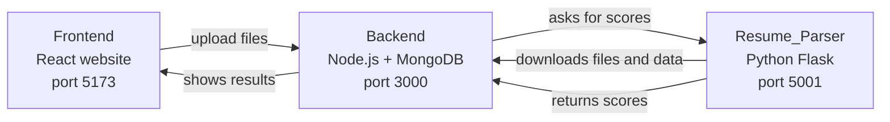
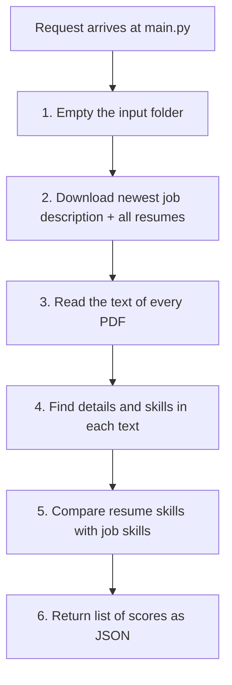
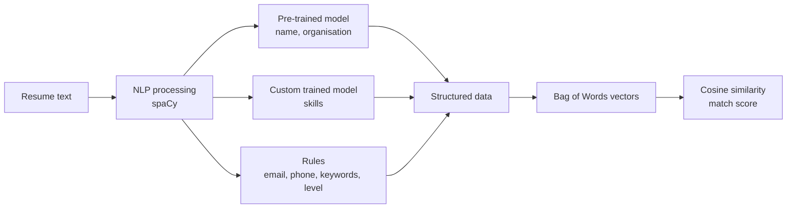
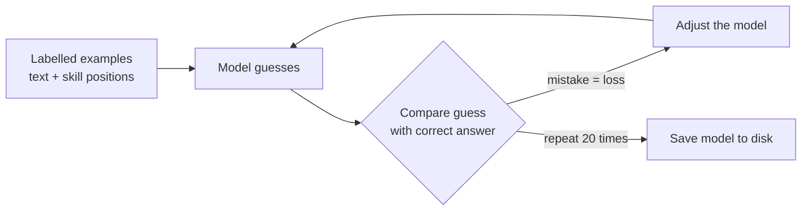

# Resume_Parser - Documentation

This folder is the "brain" of the project. It reads resumes and a job description, finds the skills written in them, and gives every resume a score that says how well it fits the job.

---

## 1. What problem does it solve?

A company may get hundreds of resumes for one job. Reading all of them takes a long time.

This module does the reading automatically:

1. It reads the job description and finds the **skills** the job needs (for example: Python, SQL, AWS).
2. It reads every resume and finds the skills each candidate has.
3. It compares the two and gives each resume a **score from 0 to 100**.
4. The higher the score, the better the resume fits the job.

---

## 2. Words you will see in this document

| Word | Simple meaning |
|------|----------------|
| **Resume / CV** | A document where a candidate lists their experience and skills. |
| **Job Description (JD)** | A document that describes the job and what skills are needed. |
| **Skill** | Something a person can do, such as "Python" or "Machine Learning". |
| **API** | A way for two programs to talk to each other over the network. |
| **Endpoint** | One specific address of an API, like a single door into a building. |
| **Flask** | A small Python tool used to build an API. |
| **spaCy** | A Python library that understands human language (English text). |
| **NER (Named Entity Recognition)** | A technique where the computer finds "names of things" inside text, such as people, companies, or (here) skills. |
| **Model** | A program that learned from examples. Ours learned what a "skill" looks like. |
| **Cosine similarity** | A maths method that tells how similar two lists of words are. |

---

## 3. Where this module fits in the full project

The project has three parts. This folder is part 3.



In plain words:

- The **Frontend** is the website the HR person uses.
- The **Backend** stores files and data (in the `backend/upload` folder and in MongoDB).
- **Resume_Parser** does the smart work: reading the files and calculating scores.

---

## 4. Folder contents

```
Resume_Parser/
├── main.py              Starts the Python API (the entry point)
├── init.py              Downloads the resumes and job description
├── processor.py         Opens the PDFs and pulls information out of them
├── extractors.py        Small functions that find name, email, skills, etc.
├── calculate_score.py   Compares skills and creates the score
├── requirement.txt      List of Python libraries to install
├── .env.example         Example settings file (not used by the code yet)
├── data/                Lists of words (skills, majors, positions)
├── TrainedModel/Model1/ The trained skill-finding model
├── Training/            Script that trains the model
└── input/               Temporary folder where files are downloaded
```

### What each file does

| File | Job |
|------|-----|
| `main.py` | Creates the Flask API. It has one endpoint, `/calculate-matching-scores`, which runs the whole process. |
| `init.py` | Asks the backend for the newest job description and all resumes, then saves them into the `input/` folder. |
| `processor.py` | Opens each PDF, extracts its text, and uses `extractors.py` to collect details. Also links each file to its database record. |
| `extractors.py` | Contains the "finder" functions: name, email, phone number, university, skills and experience level. |
| `calculate_score.py` | Turns the skills into numbers and calculates the match percentage. |
| `Training/train_model1.py` | Teaches the model what a skill looks like. Run it only if you want to retrain the model. |
| `data/newSkills.csv` | The list of known skills used for keyword search. |

---

## 5. Complete working, step by step

When the backend calls `POST /calculate-matching-scores`, this is what happens:



### Step 1 - Empty the input folder
`main.py` deletes everything inside `input/`. This makes sure old files from a previous run do not mix with the new ones.

### Step 2 - Download the files
`init.py` talks to the backend:

- `GET /jd/latest` gives the newest job description. It is saved as `input/job_description.pdf`.
- `GET /resumes` gives the list of all resumes. Each one is downloaded into `input/` using its original file name.

### Step 3 - Read the PDFs
`processor.py` opens each PDF with the **PyMuPDF** library and joins the text of all pages together. That text is then passed to **spaCy**, which splits it into words and sentences and marks what kind of word each one is.

### Step 4 - Find the details
For each document (the job description and every resume), `extractors.py` looks for:

| Detail | How it is found |
|--------|-----------------|
| **Name** | spaCy marks words that look like a person's name; the first match with two capitalised words is used. |
| **Email** | spaCy has a built-in rule for things that look like emails. |
| **Phone number** | A pattern (regular expression) that matches common phone formats. |
| **Education** | Company/organisation names that contain "university", "college" or "institute". |
| **Experience level** | Looks at action verbs. "lead/manage/direct" gives **Senior**, "develop/design/analyze" gives **Mid-Senior**, "assist/support/collaborate" gives **Mid-Junior**, anything else gives **Entry Level**. |
| **Skills** | Found in two ways, explained next. |

#### How skills are found (two ways combined)

1. **Keyword search** - The code checks every word in `data/newSkills.csv` (for example "Python", "Docker") and keeps the ones that appear in the text.
2. **AI model (NER)** - The trained model in `TrainedModel/Model1` reads the text and marks pieces of text that look like a skill. This can catch skills that are not in the CSV list.

The results of both are joined into one list of skills with no duplicates.

### Step 5 - Calculate the score
`calculate_score.py` does this for every resume:

1. Write the resume skills as one line of text, e.g. `"python sql aws"`.
2. Write the job skills the same way, e.g. `"python aws docker"`.
3. Count how many times each word appears in each line (this turns words into numbers).
4. Use **cosine similarity** to measure how close the two lists are.
5. Multiply by 100 to get a percentage.

**Easy example**

| | Python | SQL | AWS | Docker |
|---|:-:|:-:|:-:|:-:|
| Job needs | yes | no | yes | yes |
| Resume has | yes | yes | yes | no |

They share 2 skills (Python, AWS), so the score is a medium value (around 67). A resume that has all the job skills scores 100. A resume with none scores 0.

### Step 6 - Send the answer back
The API returns a list like this:

```json
[
  {
    "filename": "john_doe.pdf",
    "matching_score": 66.67,
    "skills_matched": ["python", "aws"],
    "reference_id": "665f1c...",
    "url": "http://localhost:3000/upload/1790948319799-john_doe.pdf"
  }
]
```

| Field | Meaning |
|-------|---------|
| `filename` | Original name of the resume. |
| `matching_score` | Match percentage (0 to 100). |
| `skills_matched` | Skills that appear in both the resume and the job description. |
| `reference_id` | The resume's ID in the database. |
| `url` | Link to open the resume file. |

The backend saves this list in MongoDB and the website shows it as a ranked table.

---

## 6. How the skill model was created (training)

`Training/train_model1.py` creates the model in `TrainedModel/Model1`.

1. It starts with an empty English model.
2. It is given about 150 short example sentences where the skills are marked. For example: in `"Proficient in Python, Java, and C++"`, the words Python, Java and C++ are marked as `SKILL`.
3. The model reads the examples 20 times and slowly learns the pattern of what a skill looks like.
4. The finished model is saved to `TrainedModel/Model1`.

To retrain it (only needed if you change the examples):

```bash
cd Resume_Parser
python Training/train_model1.py
```

---

## 7. AI and Machine Learning concepts used

This section explains the "smart" ideas behind the code, in simple words. You do not need to know them to run the project, but they explain **why** it works.

### 7.1 The big picture: AI, ML and NLP

| Term | Simple meaning | Where it is used here |
|------|----------------|-----------------------|
| **AI (Artificial Intelligence)** | Making computers do tasks that normally need human thinking, like reading a resume. | The whole module. |
| **ML (Machine Learning)** | A part of AI where the computer **learns from examples** instead of following hand-written rules. | The skill model (`TrainedModel/Model1`) and the pre-trained spaCy model. |
| **NLP (Natural Language Processing)** | A part of AI that works with human language (text). | Reading resumes, finding names, organisations and skills. |
| **Rule-based approach** | Fixed rules written by a programmer, no learning. | Email, phone, keyword search and experience level. |

This project uses a **hybrid approach**: some parts are learned (ML) and some are plain rules. Using both makes the result more reliable than using only one.



### 7.2 NLP basics done by spaCy

When `processor.py` calls `nlp(text)`, spaCy runs the text through a **pipeline** (a chain of small steps). The results are stored in a `doc` object that the extractors use.

| Step | What it means | Example | Used for |
|------|---------------|---------|----------|
| **Tokenization** | Split text into words and symbols (tokens). | `"I manage teams"` becomes `I`, `manage`, `teams` | Everything. |
| **POS tagging** (Part of Speech) | Label each token as noun, verb, etc. | `manage` is a VERB | `extract_experience()` looks only at verbs. |
| **Lemmatization** | Reduce a word to its base form. | `managed`, `managing`, `manages` all become `manage` | Lets the code match "managed" with the rule word "manage". |
| **NER** (Named Entity Recognition) | Find real-world names in text. | `Google` is an ORG, `John Smith` is a PERSON | Name and education extraction. |

### 7.3 Named Entity Recognition (NER)

NER means "find and label the important names in text". Think of it as a smart highlighter pen that also writes the type of each highlighted item.

```
Text:   Proficient in Python and worked at Google.
Result: Python -> SKILL      Google -> ORG
```

Two different NER models are used:

| Model | Made by | Labels it finds | Used in |
|-------|---------|-----------------|---------|
| `en_core_web_sm` | spaCy team (**pre-trained**, downloaded) | `PERSON`, `ORG`, dates, places, ... | `extract_name()` and `extract_education_from_resume()` |
| `TrainedModel/Model1` | **This project** (custom trained) | `SKILL` | `extract_skills_from_ner()` |

Why train our own? The ready-made model knows people and companies, but it does not know that "TensorFlow" or "Kubernetes" is a skill. So we taught a new model.

After the model finds skills, a small clean-up rule removes results that are one character long or contain digits, to avoid obvious mistakes.

### 7.4 How the custom skill model is trained

This is **supervised learning**: the computer is shown examples **with the correct answers**, and it learns the pattern.



The key terms, as used in `Training/train_model1.py`:

| Term | Simple meaning | In this project |
|------|----------------|-----------------|
| **Training data** | Examples with correct answers. | About 150 short sentences such as `("Proficient in Python", {"entities": [(14, 20, "SKILL")]})`. The numbers say "characters 14 to 20 are a SKILL". |
| **Label** | The category name. | `SKILL` |
| **Blank model** | A model that knows nothing yet. | `spacy.blank("en")` - only English tokenization, no knowledge. |
| **Loss** | A number showing how wrong the model is. Lower is better. | Printed after every iteration. |
| **Iteration / Epoch** | One full pass over all examples. | 20 passes. |
| **Shuffling** | Mixing the example order every pass so the model does not memorise the order. | `random.shuffle(data)` |
| **Dropout** | Randomly ignoring some of the model's connections while training, to stop it from memorising. | `drop=0.5` (50%) |
| **Weights** | The numbers inside the model that store what it has learned. | Saved in `TrainedModel/Model1/ner/model`. |

What is inside `TrainedModel/Model1/`:

| File / folder | Contains |
|---------------|----------|
| `config.cfg` | Settings used to build the model. |
| `meta.json` | Name, version and labels of the model. |
| `tokenizer` | Rules to split text into tokens. |
| `ner/` | The learned weights (the actual "knowledge"). |
| `vocab/` | The word list the model knows. |

### 7.5 Rule-based techniques (no learning)

Not everything needs ML. For simple, predictable patterns, rules are faster and more exact.

| Technique | What it is | Used for |
|-----------|------------|----------|
| **Regular expression (regex)** | A short pattern that describes text shapes, e.g. "3 digits, 3 digits, 4 digits". | Phone number. |
| **spaCy Matcher** | Looks for token patterns, e.g. `LIKE_EMAIL`. | Email address. |
| **Keyword (dictionary) matching** | Check if each word from a list appears in the text. | Skills from `data/newSkills.csv`. |
| **Heuristic** | A "rule of thumb" guess. | Experience level from verbs (`lead` means Senior, `assist` means Mid-Junior). |

The experience level is only a rough guess. It is not learned from data.

### 7.6 Turning text into numbers: Bag of Words

Computers cannot compare words directly, only numbers. **Bag of Words** counts how many times each word appears and ignores the word order, like emptying a bag of letter tiles and counting each kind.

The code uses `CountVectorizer` from scikit-learn:

```
Job skills:     python aws docker
Resume skills:  python sql aws

Vocabulary:  [aws, docker, python, sql]
Job vector:     [1, 1, 1, 0]
Resume vector:  [1, 0, 1, 1]
```

Each list of numbers is called a **vector**.

Good to know about `CountVectorizer`'s default behaviour:
- It turns everything to lowercase.
- It splits on spaces and symbols and **drops single-character words**. So `machine learning` becomes two words (`machine`, `learning`), `node.js` becomes `node` and `js`, and `C` or `C++` disappear.

### 7.7 Measuring similarity: Cosine similarity

Once both lists are vectors, we need one number that says "how alike are they?". **Cosine similarity** measures the angle between two vectors:

- Same direction (same skills) means the angle is 0 and the result is **1** (100%).
- Nothing in common means the angle is 90 degrees and the result is **0** (0%).

```
                 (job vector) . (resume vector)
similarity = -----------------------------------------
              length(job vector) x length(resume vector)
```

Worked example with the vectors above:

```
dot product      = 1x1 + 1x0 + 1x1 + 0x1 = 2
length of job    = sqrt(1+1+1+0) = sqrt(3)
length of resume = sqrt(1+0+1+1) = sqrt(3)
similarity       = 2 / (sqrt(3) x sqrt(3)) = 2 / 3 = 0.667
score            = 0.667 x 100 = 66.67 %
```

Why cosine similarity? It compares **what skills are present**, not how long the text is, so a short resume is not unfairly punished against a long one.

This step does **not** use training. It is a fixed maths formula, so it is not machine learning by itself. It is the "comparison" part that sits on top of the ML skill extraction.

### 7.8 Strengths and weaknesses of this AI design

| Strength | Weakness |
|----------|----------|
| Easy to understand and explain: score comes from shared skills. | The model learned from only about 150 examples, so it can miss skills it has not seen. |
| Fast: no heavy computation or GPU needed. | No test data was used, so we do not know its real accuracy (no precision/recall numbers). |
| Hybrid (keywords + ML) catches more skills. | Bag of Words does not understand meaning: `ReactJS` and `React` are different words, and `ML` is not linked to `Machine Learning`. |
| Works offline with no paid AI service. | A resume with many extra skills gets a lower score, because cosine similarity also looks at the size of the resume's list. |

### 7.9 Ideas to improve the AI part

- **More and better training data**, plus a separate test set to measure accuracy (precision = how many found skills are correct, recall = how many real skills were found).
- **TF-IDF weighting** so rare, important skills count more than common ones.
- **Word embeddings or sentence embeddings** (for example spaCy vectors or sentence-transformers) so similar skills such as "ML" and "Machine Learning" are treated as close in meaning.
- **Skill synonyms list** to merge different spellings into one.
- Include **experience and education** in the score, not only skills.

---

## 8. Setup and running

**Requirements:** Python 3.8 or newer. The backend must be running on port 3000.

```bash
cd Resume_Parser

# 1. Create and activate a virtual environment (isolated Python)
python -m venv venv
venv\Scripts\activate          # Windows

# 2. Install libraries
pip install -r requirement.txt

# 3. Download the English language model used by spaCy
python -m spacy download en_core_web_sm

# 4. Start the API
python main.py
```

The API now runs at `http://localhost:5001`.

**Start order for the whole project:** MongoDB, then the Backend (`npm start` in `backend/`), then this Python API, then the Frontend (`npm run dev` in `frontend/`).

### Libraries used

| Library | Used for |
|---------|----------|
| `flask`, `flask-cors` | Creating the API and allowing the website to call it. |
| `requests` | Downloading files from the backend. |
| `pymupdf` | Reading text from PDF files. |
| `spacy` | Understanding English text and finding skills. |
| `nltk` | Text tools (downloads the `punkt` data on start). |
| `scikit-learn` | Counting words and calculating similarity. |
| `pandas` | Installed, but not used in the current code. |

---

## 9. API reference

### `POST /calculate-matching-scores`

Runs the full process described in section 5.

- **Request body:** none needed.
- **Success:** `200` with the list of scores (see Step 6).
- **Failure:** `500` with `{"error": "reason"}`.

Common reasons for failure: backend not running, no job description uploaded, or a resume that has no record in the database.

---

## 10. Logs and troubleshooting

All activity is written to `app.log` in this folder. Open it first when something goes wrong.

| Problem | Likely cause | Fix |
|---------|--------------|-----|
| `Can't find model 'en_core_web_sm'` | spaCy language model not installed. | Run `python -m spacy download en_core_web_sm`. |
| `Error fetching resumes data` in log | Backend is not running. | Start the backend on port 3000. |
| `No such file ... job_description.pdf` | No job description was uploaded, or it failed to download. | Upload again from the website. |
| `No existing document found for ...` | A PDF is in `input/` that is not in the database. | Upload again; the folder is emptied on each run. |
| Port 5001 already in use | Another copy is running. | Stop it, then restart. |

---

## 11. Current limitations

Good to know when using or improving the project:

- **PDF only.** DOC and DOCX files are downloaded but not read.
- **Skills only.** The score uses only skills. Experience level, education, name and email are extracted but are not part of the score.
- **Keyword matching is simple.** The check is "does this word appear anywhere in the text", so short skills like `Go` or `C` can match inside other words, and the CSV header word `Text` is also treated as a skill.
- **Same file names clash.** Two resumes with the same original file name overwrite each other in `input/`.
- **Unused files and settings.** Only `data/newSkills.csv` is used. The other CSV files and the values in `.env.example` are not read by the code yet.
- **Download on start-up.** `init.py` runs a download as soon as it is imported, so a download also happens when the API starts.

---

## 12. Quick summary

> Download files, read the text, find skills (keywords plus a trained NER model), turn skills into word-count vectors (Bag of Words), compare resume and job vectors with cosine similarity, and return a percentage score for each resume.
